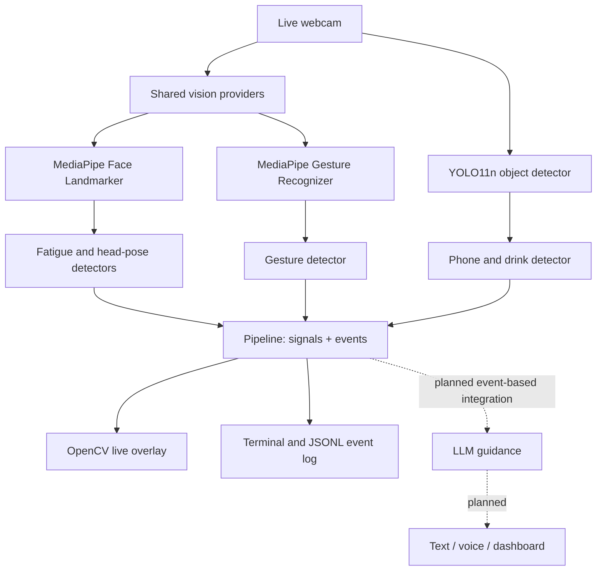

<div align="center">

# 🏁 AI VIBECODERS
### DRIVER MONITORING · RACE-INSPIRED SAFETY TELEMETRY

**CodeLap Hackathon 2026 · Porsche Engineering · AI Drive Challenge**

**SEE THE DRIVER. READ THE SIGNALS. REACT IN TIME.**

`LIVE CAMERA` · `COMPUTER VISION` · `EVENT TELEMETRY` · `LLM-READY`

</div>


## 🏁 Starting grid — 60-second overview

| Question | Answer |
|---|---|
| **What is it?** | A real-time, webcam-based prototype that monitors driver attention and potentially unsafe behaviors. |
| **What can it detect?** | Eye closure / drowsiness indicators, looking away, visible phones and drinks, and recognized hand gestures. |
| **What does it show?** | A live annotated camera feed, current detector signals, recent events, terminal output and saved session logs. |
| **How does it work?** | MediaPipe tracks face and gesture features; YOLO11n finds selected objects; temporal logic turns observations into events. |
| **How do I run it?** | Install Python dependencies, download model weights, run `python run.py`, and look into the webcam. |
| **Where does an LLM fit?** | Downstream of the event pipeline: convert events into short, context-aware alerts without uploading every video frame. **Planned, not yet integrated.** |

## 🏎️ Live capabilities — the onboard systems

| Module | Technology | How it works | Status |
|---|---|---|---|
| **Driver fatigue signals** | MediaPipe Face Landmarker + geometric/temporal rules | Tracks eye closure, eye-closure proportion (PERCLOS), and mouth opening over time. | ✅ Implemented |
| **Attention / head pose** | MediaPipe face landmarks, pose matrix and calibration | Compares head orientation with the driver's initial forward-facing baseline. | ✅ Implemented |
| **Phone / drink detection** | Ultralytics **YOLO11n**, pretrained object detection | Detects visible objects, filters to an approximate driver region and confirms detections across frames. | ✅ Implemented |
| **Hand gestures** | MediaPipe Gesture Recognizer | Classifies supported gestures and requires a sustained score before emitting events. | ✅ Implemented |
| **On-screen telemetry** | OpenCV | Draws detector information, FPS and recent events over the live feed. | ✅ Implemented |
| **Event recorder** | Python + JSON Lines | Prints safety events and writes one structured JSON record per event. | ✅ Implemented |
| **AI copilot responses** | Groq / Gemini or another LLM | Would translate event data into concise, contextual in-car guidance. | 🛠️ Planned |
| **Voice + dedicated web dashboard** | To be selected | Would speak warnings and show LLM responses in a separate UI. | 🛠️ Planned |

**Scope note:** These detections are heuristic indicators, **not** validated measurements of impairment or proof of unsafe driving. The phone detector recognizes a visible phone; it does not conclusively prove active use.

## ⚙️ Under the hood — system architecture



**Why this architecture?** The shared providers avoid repeating expensive face/gesture inference unnecessarily. Detectors independently produce **continuous signals** (for monitoring) and **discrete events** (for reactions). The event boundary is also the right place to attach an LLM: call it when something meaningful happens, not 30 times per second.

### The telemetry loop

1. **Capture** — OpenCV reads a live camera frame.
2. **Perceive** — MediaPipe extracts face and gesture information; YOLO11n detects relevant objects.
3. **Evaluate** — Detector-specific thresholds, calibration and temporal checks reduce single-frame noise.
4. **Publish** — `Pipeline.process(frame)` returns signals and structured events.
5. **Display / record** — OpenCV renders live feedback; the terminal and `logs/` record events.
6. **React (next integration)** — An LLM can convert a safety event into a brief warning; a local fallback should work if the API fails.

## 🚦 Green light — run the demo

### Prerequisites

- **Windows 11** and **64-bit Python 3.12** (environment targeted by the pinned dependencies)
- Working webcam (built-in or USB)
- Internet connection **for first-time installation and model downloads**
- Terminal / PowerShell, preferably from the repository root

### 1. Install dependencies

```powershell
py -3.12 -m venv .venv
.venv\Scripts\Activate.ps1
$env:PYTHONUTF8=1
python -m pip install -r requirements.txt
```

> If PowerShell blocks activation, use `.venv\Scripts\python.exe` instead of `python` in the following commands. YOLO's PyTorch dependency can be a substantial download.

### 2. Download models and run a smoke test

```powershell
python scripts/download_models.py
python tools/smoke_test.py
```

The download script obtains the MediaPipe face/gesture model assets and YOLO11n weights into the local `models/` directory.

### 3. Start the live camera

```powershell
python tools/test_camera.py   # Optional camera check
python run.py                # Default: drowsiness + head pose
```

**Important: first 5 seconds = calibration lap.** Face the camera, keep your eyes open and hold a neutral forward-facing head position. Recalibrate whenever the camera moves.

### 4. Select your detectors

```powershell
python run.py --detectors drowsiness
python run.py --detectors head_pose
python run.py --detectors phone
python run.py --detectors gestures
python run.py --detectors drowsiness,head_pose,phone,gestures
python run.py --camera 1  # Try another camera index
```

| Key | Action |
|---|---|
| `q` | Quit the live demo |
| `c` | Restart calibration |

**Expected output:** a live OpenCV window with camera imagery and detector overlays, terminal `[EVENT]` lines when event conditions are met, and `logs/session_YYYYMMDD_HHMMSS.jsonl` files. **No API key is needed for the currently implemented CV demo.**

## 📊 Driver telemetry — how detection decisions are made

| Detector | Signal / rule | Default event trigger |
|---|---|---|
| **Drowsiness** | Eye aspect ratio against calibrated baseline; PERCLOS; mouth aspect ratio | Eyes closed **≥ 1.0 s**, PERCLOS **≥ 25% in a 60 s window**, or mouth open **≥ 1.2 s** |
| **Head pose** | Yaw / pitch relative to the calibrated forward pose; gaze-down cues | Looking away **≥ 2 s** |
| **Phone / drink** | YOLO11n detections inside an approximate driver zone, with temporal voting | Seen in **3 of 5** recent YOLO passes and sustained **≥ 1 s** |
| **Gestures** | MediaPipe gesture class score and duration | Score **≥ 0.6** sustained **≥ 0.5 s** |

Thresholds are **demo configuration**, not automotive-certified safety limits. Adjust them in [`src/dms/config.py`](src/dms/config.py). A **5-second event cooldown** helps prevent repetitive notifications. The current multi-person heuristic chooses the **largest visible face** as the driver's face; it is not robust driver identification. Head-down posture can suppress misleading eye-closure interpretation.

### Example event payload

The pipeline exposes a structured event with fields such as:

```json
{
  "type": "distraction",
  "severity": "warning",
  "source": "head_pose",
  "confidence": 0.9,
  "data": {"direction": "down"},
  "ts": 1763720000.0
}
```

*Illustrative schema example, not an actual recorded event; values and detector-specific `data` fields depend on the triggered event.*

## 🧠 The AI pit crew — LLM integration strategy

**Why an LLM?** A detector can report *“head down for 2 seconds”*. A language model can turn that event into short, natural guidance such as *“Please keep your attention on the road.”* The model is an **advisory language layer**, not the safety-critical detector.

**Planned integration:**

```text
CV event → event filter + cooldown → compact JSON prompt
         → Groq or Gemini API → short response
         → live text / optional speech
         → predefined local warning on timeout or API failure
```

- **Cost and latency:** Send **events**, not every webcam frame; cache common warnings.
- **Reliability:** Keep detection and immediate local warnings independent of network/API availability.
- **Privacy:** Avoid sending raw camera footage when event metadata is sufficient.
- **Driver experience:** Prefer short, calm, non-distracting instructions; avoid speculative medical claims.
- **Secrets:** Keep API keys in local environment variables or `.env` files; **never commit them**.

**Current status:** This is an integration plan. The uploaded snapshot does **not** contain a working Groq/Gemini call, LLM alert rendering or speech synthesis. Do not present the example response as live functionality until integrated.

## 🏆 Hackathon scrutineering — R1 to R4

| Requirement | Jury expects | What this repository demonstrates |
|---|---|---|
| **R1 · Detect** | Computer vision reads driver attention/activity | **Implemented** — live fatigue, head pose, phone/drink and gesture detectors |
| **R2 · React** | An **LLM** drives an in-car warning, dialogue or voice reaction | **Not yet complete** — structured event output exists; LLM call is pending |
| **R3 · Run live** | Real camera feed, no pre-labeled/postprocessed demo | **Implemented in code** — live webcam pipeline; verify on the demo laptop |
| **R4 · Show live** | Live categories/detections **and** LLM text/audio suggestion | **Partial** — OpenCV overlay exists; LLM suggestions are pending |

The workshop also asks for a **public Git repository, clear README, repeatable startup instructions, regular commits, and a presentation/demo**. This documentation supports those deliverables; completing R2 and R4 requires additional implementation.

### Suggested judge demo (once the LLM is integrated)

1. **Launch** the webcam and show the calibration step.
2. **Look straight ahead** — establish the neutral state.
3. **Look away/down** for the configured interval — show the CV event and its telemetry.
4. **Trigger a second event** (e.g., visible phone) — show distinct categories.
5. **Show the LLM-generated message** in the live interface and explain event-based API usage.
6. **Show graceful fallback** by temporarily disabling network access, if implemented.

For the current code-only snapshot, steps 1–4 are the relevant live demonstration; steps 5–6 are planned.

## 🗂️ Garage layout — repository map

```text
AI_VibeCoders/
├── run.py                     # Live camera loop, OpenCV overlay, event logging
├── requirements.txt           # Pinned Python dependencies
├── scripts/
│   └── download_models.py     # Fetches model assets
├── tools/
│   ├── test_camera.py         # Camera diagnostics
│   └── smoke_test.py          # Pipeline smoke test
├── src/dms/
│   ├── config.py              # Settings, calibration, thresholds
│   ├── events.py              # Event model, severity and cooldown
│   ├── providers.py           # Shared MediaPipe providers
│   ├── face_utils.py          # Facial geometry utilities
│   ├── pipeline.py            # Detector orchestration
│   └── detectors/
│       ├── base.py            # Detector interfaces
│       ├── drowsiness.py      # Eye / mouth / fatigue signals
│       ├── head_pose.py       # Orientation and distraction
│       ├── phone.py           # YOLO11n phone / drink recognition
│       └── gestures.py        # Gesture classification
├── models/                    # Downloaded weights (not committed)
├── logs/                      # Session JSONL telemetry (not committed)
└── presentation/              # Hackathon slides
```

## 🔧 Troubleshooting — pit stop checklist

| Symptom | What to try |
|---|---|
| Camera doesn't open | Close other camera apps; run `python tools/test_camera.py`; try `--camera 1`. |
| No face/head results | Improve lighting, face the camera, press `c` to recalibrate. |
| Phone detection is absent | Enable it explicitly with `--detectors phone`; keep the object visible in frame. |
| Startup is slow | Check that models were downloaded and dependencies installed; first inference may take longer. |
| No events appear | A detection must satisfy its duration/threshold rules; ordinary frames may produce no events. |
| API key / LLM missing | Expected in this snapshot: LLM integration has not been added yet. |

## 🛡️ Safety, privacy and limitations

This is a **hackathon research/demo prototype**, not a validated driver monitoring system or an automotive safety component. Test with a **stationary vehicle or controlled indoor setup**. Do not rely on it to make real driving decisions. Performance can degrade with lighting, sunglasses, camera placement, occlusion, multiple occupants and out-of-distribution behavior. Local JSONL logs may contain behavioral event data; handle them responsibly. No formal accuracy, false-alarm-rate or safety validation results are claimed.

---

<div align="center">

### 🏁 FROM CAMERA SIGNALS TO SAFER DECISIONS

**AI VibeCoders · CodeLap Hackathon 2026**  
*Race-inspired presentation; independent hackathon prototype, not an official Porsche or Formula 1 product.*

</div>
