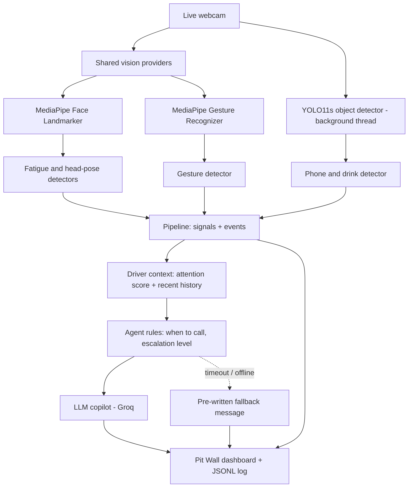

<div align="center">

# 🏁 AI VIBECODERS
### DRIVER MONITORING · RACE-INSPIRED SAFETY TELEMETRY

**CodeLap Hackathon 2026 · Porsche Engineering · AI Drive Challenge**

**SEE THE DRIVER. READ THE SIGNALS. REACT IN TIME.**

`LIVE CAMERA` · `COMPUTER VISION` · `EVENT TELEMETRY` · `LLM COPILOT` · `PIT WALL DASHBOARD`

</div>


## 🏁 Starting grid — 60-second overview

| Question | Answer |
|---|---|
| **What is it?** | A real-time, webcam-based prototype that monitors driver attention and potentially unsafe behaviors, and talks back to the driver. |
| **What can it detect?** | Eye closure / drowsiness indicators, yawns, looking away, visible phones and drinks, and hand gestures the driver uses to reply. |
| **What does it show?** | A live **Pit Wall dashboard** in the browser: camera feed with overlays, attention score, detector signals, LLM guidance, event feed, charts and saved sessions. |
| **How does it work?** | MediaPipe tracks face and hand features; YOLO11s finds selected objects; temporal logic turns observations into events; an LLM turns events into short spoken-style guidance. |
| **How do I run it?** | Install dependencies, download models, then `python dashboard/dashboard.py --detectors drowsiness,head_pose,phone,gestures --llm` and open http://127.0.0.1:8000. |
| **Where does the LLM fit?** | Downstream of the event pipeline: on each meaningful event it receives a compact JSON summary (never video) and returns a short message, priority and action. **Integrated (Groq).** |

## 🏎️ Live capabilities — the onboard systems

| Module | Technology | How it works | Status |
|---|---|---|---|
| **Driver fatigue signals** | MediaPipe Face Landmarker + geometric/temporal rules | Tracks eye closure, eye-closure proportion (PERCLOS), blinks and yawns over time. | ✅ Implemented |
| **Attention / head pose** | MediaPipe face landmarks, pose matrix, gaze blendshapes, calibration | Compares head orientation and eye gaze with the driver's calibrated forward-facing baseline. | ✅ Implemented |
| **Phone / drink detection** | Ultralytics **YOLO11s**, pretrained object detection, in a background thread | Detects visible objects, filters to an approximate driver region and confirms detections across frames. A hand holding a drink/phone is not treated as a gesture. | ✅ Implemented |
| **Hand gestures** | MediaPipe Gesture Recognizer + landmark geometry check | Gestures are the driver's replies to the copilot (see table below). | ✅ Implemented |
| **Attention score** | Rule-based, 0–100 | Combines eye closure, PERCLOS, looking away, phone and yawns into one smoothed number. | ✅ Implemented |
| **AI copilot responses** | Groq LLM (`openai/gpt-oss-20b`), OpenAI-compatible client | Turns events into short, contextual guidance with escalation levels; local fallback if the API fails. | ✅ Implemented |
| **Pit Wall dashboard** | FastAPI + HTML/JS | Live camera, attention, signals, LLM guidance, events, charts, session archive and CSV export. | ✅ Implemented |
| **Event recorder** | Python + JSON Lines | Writes one structured JSON record per event and per assistant reply. | ✅ Implemented |
| **Hands on the wheel** | MediaPipe hand landmarks + virtual steering wheel | A laptop camera can't see a real wheel, so the upper half of a see-through wheel is drawn in the lower-left corner, in front of the driver (camera on the roof between the seats: driver left, passenger right). At least one hand on it = OK; no hand for 2 s = warning, 5 s = critical. Starts checking once the hands were on the wheel. On by default (`--no-wheel` hides it). | ✅ Implemented |
| **Automatic recalibration** | Pipeline rules | Driver seat empty ≥ 15 s, then a face appears → full recalibration (new driver). Every 10 min, only while the driver is alert → background baseline refresh that keeps the fatigue history. | ✅ Implemented |
| **Trip copilot: rest stop / hotel** | `fatigue.py` + `trip.py` + `trip_copilot.py`, Leaflet map | Fatigue events build a fatigue **level** (0 ok · 1 tired · 2 very tired) that fades over time. Tired → the **code** picks the next rest area / fuel+coffee stop **ahead on the route**; very tired → the next **hotel** (or "stop now" if none is in reach). The LLM only says the chosen place (name + distance), it never invents one. Simulated drive on the **real road Cluj-Napoca → Sibiu (180 km)** with **428 real places from OpenStreetMap** (rest areas, fuel stations, malls, hotels/guesthouses), shown on a live map with demo buttons. Works offline (data saved in `data/`). | ✅ Implemented |
| **Driver + passengers** | Face position tracking | Driver = the face at the calibrated seat position (green box); every other face is a passenger (blue box). The copilot can ask a passenger to help when the driver is very tired. | ✅ Implemented |
| **AI voice** | Groq TTS (Orpheus, voice "troy") + pygame playback; offline fallback `pyttsx3` | Speaks each copilot message on the laptop; critical alerts interrupt. The fixed sentences (fallbacks, gesture replies) are pre-generated into `voice_cache/`, so the natural voice also works without the LLM. | ✅ Implemented |
| **Sound + visual alerts** | Web Audio + CSS | Beep before warnings, double tone + red panel flash for critical. The dashboard **VOICE** button turns the voice on/off (browser speech is used only if the AI voice isn't running). | ✅ Implemented |

**Scope note:** These detections are heuristic indicators, **not** validated measurements of impairment or proof of unsafe driving. The phone detector recognizes a visible phone; it does not conclusively prove active use.

## ⚙️ Under the hood — system architecture



**Why this architecture?** The shared providers avoid repeating expensive face/gesture inference. Detectors independently produce **continuous signals** (for the dashboard) and **discrete events** (for reactions). The event boundary is the right place to attach an LLM: call it when something meaningful happens, not 30 times per second.

### The telemetry loop

1. **Capture** — OpenCV reads a live camera frame.
2. **Perceive** — MediaPipe extracts face and hand information; YOLO11s detects relevant objects in a background thread, so the video never waits for it.
3. **Evaluate** — Detector-specific thresholds, calibration and temporal checks reduce single-frame noise.
4. **Publish** — `Pipeline.process(frame)` returns signals and structured events.
5. **React** — The agent decides whether the event deserves a message, sets the escalation level, and asks the LLM what to say (in a background thread).
6. **Display / record** — The dashboard shows everything live; `logs/` records events and replies.

## 🚦 Green light — run the demo

### Prerequisites

- **Windows 11** and **64-bit Python 3.12** (environment targeted by the pinned dependencies)
- Working webcam (built-in or USB)
- Internet connection **for installation, model downloads and the LLM**
- Terminal / PowerShell, from the repository root

### 1. Install dependencies

```powershell
py -3.12 -m venv .venv
.venv\Scripts\Activate.ps1
$env:PYTHONUTF8=1
python -m pip install -r requirements.txt
```

> If PowerShell blocks activation, use `.venv\Scripts\python.exe` instead of `python` in the following commands. YOLO's PyTorch dependency can be a substantial download.

### 2. Download models and run a smoke test

```powershell
python scripts/download_models.py
python tools/smoke_test.py
```

### 3. Add your LLM key (for the copilot)

```powershell
copy .env.example .env      # then put your own GROQ_API_KEY in .env
python tools/test_llm.py    # sends a few test situations, no camera needed
```

`.env` is git-ignored — **never commit API keys**. Each team member uses their own free Groq key.

### 4. Start the Pit Wall dashboard (main demo)

```powershell
python dashboard/dashboard.py --llm
# same as: --detectors drowsiness,head_pose,phone,gestures --llm
# the virtual steering wheel is always on; hide it with --no-wheel
```

Open **http://127.0.0.1:8000**. With `--llm` the AI voice speaks on the laptop (button shows **VOICE ON · AI**; click it to mute). Click the page once so the browser may play the alert beeps. Leave out `--llm` to run without the LLM (no API usage; pre-written guidance is shown instead).

Under **Processing speed** the dashboard shows where each frame's time goes (`camera · AI · video` in ms). If the camera part is the largest, the webcam itself is slow — usually not enough light.

**Important: first 5 seconds = calibration lap.** Face the camera, keep your eyes open and hold a neutral forward-facing head position. Use **RECALIBRATE** whenever the camera moves.

### 5. Debug window (optional)

`run.py` shows the same pipeline in an OpenCV window with extra debug text — useful for tuning thresholds:

```powershell
python run.py --detectors drowsiness,head_pose,phone,gestures --llm
python run.py --detectors gestures      # test one detector at a time
python run.py --camera 1                # try another camera index
```

| Key | Action |
|---|---|
| `q` | Quit |
| `c` | Restart calibration |

**Both apps use the camera — run only one at a time.**

## 🗺️ Trip copilot — where should a tired driver stop?

| Fatigue level | How it's reached | What the copilot recommends |
|---|---|---|
| 0 – OK | default | nothing |
| 1 – tired | e.g. 3 yawns, or PERCLOS high | the next **rest area / fuel station / mall** ahead on the route (≤ 40 km) |
| 2 – very tired | e.g. repeated eye closures | the next **hotel** ahead (≤ 60 km); if none, the nearest place to **stop now** |

- Events add points that fade (half-life 2 min) with hysteresis, so one yawn never sends you to a hotel.
- Places are judged by **distance ahead along the route**, not straight-line distance.
- 👎 thumbs down ("I need a break") always gets a pit-stop suggestion.
- **Demo controls** on the dashboard: *Simulate: tired / very tired / reset*, trip speed, jump along the route — so the demo doesn't depend on actually being tired.
- **Real data, offline:** `data/route_cache.json` = the real road geometry (OSRM), `data/poi_cache.json` = real places within 2.5 km of the road (OpenStreetMap, © OpenStreetMap contributors), both fetched once and saved. Only places **at least 300 m ahead** are suggested (closer is too late to turn in). Distances are spoken naturally ("500 meters", "4.5 kilometers"). If the `data/` files are missing, a demo route with made-up demo places is used.
- Map background tiles © OpenStreetMap contributors (internet needed for the background; the route and pins draw offline).
- Start option: `--trip-speed 20` (simulated speed-up, 1 = real time).

## 📊 Driver telemetry — how detection decisions are made

| Detector | Signal / rule | Default event trigger |
|---|---|---|
| **Drowsiness** | Eye aspect ratio against calibrated baseline; PERCLOS; mouth aspect ratio | Eyes closed **≥ 1.0 s**, PERCLOS **≥ 25% in a 60 s window**, or mouth open **≥ 1.2 s** |
| **Head pose** | Yaw / pitch relative to the calibrated forward pose; gaze-down cues | Looking away **≥ 2 s** (down = critical). |
| **Phone / drink** | YOLO11s detections inside an approximate driver zone, with temporal voting; a "phone" covered by a flat hand (straight fingers) is rejected | Phone: **3 of 5** recent YOLO passes; drink: **2 of 5** (often half-hidden by the hand); sustained **≥ 1 s**. Optional **phone call pose** (off by default, `call_pose_enabled`): hand at the ear for 2 s + a phone seen near the head in 3 separate checks |
| **Gestures** | Gesture model + landmark geometry check, majority vote | Same gesture in **6 of 10** frames, then held **1.8 s** (open palm) or **1.0 s** (others) |

Thresholds are **demo configuration**, not automotive-certified safety limits. Adjust them in [`src/dms/config.py`](src/dms/config.py). A **5-second event cooldown** prevents repetitive notifications. **Driver vs. passenger:** the driver is the face closest to the driver's seat (left side of the image, `driver_seat_x` in the config) at calibration; only the driver's hands can make gestures; after that the system follows that seat position and ignores faces elsewhere (a passenger leaning in is not taken as the driver). Press **RECALIBRATE** to lock onto a new driver. This is a position heuristic, not identity recognition. Calibration only counts time while a face is visible. **Recalibration** happens on the RECALIBRATE button, automatically after the driver's seat was empty for 15 s (driver change), and as a 10-minute background baseline refresh that only runs while the driver is alert (a tired face is never learned as "normal"). Head-down posture suppresses misleading eye-closure interpretation.

### ✋ Gestures — the driver talks back

| Gesture | Meaning | What happens |
|---|---|---|
| 👍 Thumbs up | "I'm OK / got it" | Acknowledges the last alert, lowers the escalation level, short thank-you. **While warnings are muted: unmutes them.** |
| ✋ Open palm | "Quiet for a minute" | Mutes **warnings** for 60 s (critical alerts still come through). Must be held **1.8 s**. Unmute early with 👍 or the dashboard's **UNMUTE** button. |
| 👎 Thumbs down | "I need a break" | The copilot suggests stopping at the next safe place |
| ✌️ Victory | "How am I doing?" | The copilot gives a short status report of the drive |
| ✊ Fist | — | Ignored on purpose: hands gripping the wheel look like fists |

Only the **driver's** hands count — passenger gestures are ignored. The open palm is ignored while the driver is on the phone (phone seen or hand at the ear), and needs 4 clearly straight fingers.

### Example event payload

```json
{
  "type": "distraction",
  "severity": "warning",
  "source": "head_pose",
  "confidence": 1.0,
  "data": {"direction": "down", "seconds": 2.0},
  "ts": 1763720000.0
}
```

*Illustrative schema example; detector-specific `data` fields depend on the triggered event.*

## 🧠 The AI pit crew — LLM copilot

**Why an LLM?** A detector can report *"eyes closed 1.3 s"*. A language model sees the whole picture — three yawns, rising PERCLOS, 47 minutes of driving, an earlier warning that was ignored — and turns it into one short, calm, situational message.

```text
CV event → agent rules (cooldown, escalation level) → compact JSON summary
         → Groq LLM → {speak, priority, action, dashboard_note}
         → dashboard + log
         → pre-written local message on timeout (4 s) or API failure
```

- **Code decides *when* and *how serious*; the LLM decides *what to say*.** Escalation levels 1–4 are counted per category (fatigue / distraction); only fatigue escalates to "pull over".
- **Cost and latency:** only events are sent, never frames. Warnings are limited to one call per 12 s; info events (drinks) never call the LLM. Typical reply time: **0.2–0.6 s**.
- **Reliability:** the LLM runs in a background thread — the camera never waits for the network.
- **Privacy:** no camera footage leaves the laptop; only a few hundred characters of event metadata.
- **Honesty:** the prompt forbids inventing numbers; the LLM may only use values present in the JSON.
- **Automatic failover:** `LLM_PROVIDER` (in `.env`) is tried first; when a free-tier limit is hit the app switches by itself: Groq `gpt-oss-20b` → Groq `gpt-oss-120b` (Groq limits are per model) → extra Groq keys (`GROQ_API_KEY_2`, from another account) → Gemini `gemini-flash-lite-latest` (`GEMINI_API_KEY`) → pre-written messages. The terminal prints `[LLM] now using …` and the dashboard shows the provider that answered. The ✌️ status report is built from the real numbers when no LLM is available.

## 🗂️ Garage layout — repository map

```text
AI_VibeCoders/
├── dashboard/
│   ├── dashboard.py           # Pit Wall server: camera + pipeline + LLM, web API
│   ├── dashboard_ui.html      # Dashboard page
│   └── static/leaflet/        # map library (Leaflet 1.9.4, served locally)
├── run.py                     # Debug app: OpenCV window, overlay, event logging
├── requirements.txt           # Pinned Python dependencies
├── .env.example               # Template for API keys (copy to .env)
├── scripts/
│   └── download_models.py     # Fetches model assets
├── tools/
│   ├── test_camera.py         # Camera diagnostics
│   ├── smoke_test.py          # Pipeline smoke test
│   └── test_llm.py            # LLM test with simulated situations
├── src/dms/
│   ├── config.py              # Settings, calibration, thresholds
│   ├── events.py              # Event model, severity and cooldown
│   ├── providers.py           # Shared MediaPipe providers
│   ├── face_utils.py          # Facial geometry utilities
│   ├── pipeline.py            # Detector orchestration + timing
│   ├── perf.py                # Windows anti-throttling + FPS counter
│   ├── voice.py               # AI voice: Groq TTS, cache, offline fallback
│   ├── fatigue.py             # fatigue events -> fatigue level 0/1/2
│   ├── trip.py                # route + real places ahead, stop advisor
│   ├── trip_copilot.py        # glue: fatigue level + stop advice for LLM and map
│   ├── detectors/
│   │   ├── base.py            # Detector interfaces
│   │   ├── drowsiness.py      # Eye / mouth / fatigue signals
│   │   ├── head_pose.py       # Orientation, gaze and distraction
│   │   ├── phone.py           # YOLO11s phone / drink recognition (background thread)
│   │   ├── gestures.py        # Gesture classification + meanings
│   │   ├── occupants.py       # Driver + passenger tracking
│   │   └── wheel.py           # Hands on the (virtual) steering wheel
│   └── agent/
│       ├── llm.py             # LLM client (Groq / Gemini / Ollama)
│       ├── context.py         # Driver summary + attention score
│       └── agent.py           # When to call, escalation, prompt, fallback
├── data/                      # real road + OpenStreetMap places for the trip copilot
├── voice_cache/               # Pre-generated audio for fixed phrases
├── models/                    # Downloaded weights (not committed)
├── logs/                      # Session JSONL + dashboard sessions (not committed)
└── presentation/              # Hackathon slides
```

## 🔧 Troubleshooting — pit stop checklist

| Symptom | What to try |
|---|---|
| Camera doesn't open | Close other camera apps (and `run.py` / the dashboard — only one can use it); run `python tools/test_camera.py`; try `--camera 1`. |
| No face/head results | Improve lighting, face the camera, recalibrate. |
| Phone detection is absent | Include `phone` in `--detectors`; keep the object visible and inside the driver zone. |
| Startup is slow | Check that models were downloaded; first inference may take longer. |
| No events appear | A detection must satisfy its duration/threshold rules; ordinary frames produce no events. |
| Dashboard says "LLM off" | Start with `--llm` and check `GROQ_API_KEY` in `.env` (`python tools/test_llm.py`). |
| Low FPS | Check the `camera · AI · video` numbers under Processing speed. Large *camera* time = webcam slowed down by low light (add a lamp facing you). Close other heavy apps. |
| No voice | Check the terminal for `[VOICE]` lines (key loaded, TTS errors), the laptop volume and the VOICE button. If Groq TTS fails, the offline `pyttsx3` voice is used. |
| Guidance marked FALLBACK | The LLM timed out or the rate limit was reached; pre-written messages are used until it recovers. |

## 🛡️ Safety, privacy and limitations

This is a **hackathon research/demo prototype**, not a validated driver monitoring system or an automotive safety component. Test with a **stationary vehicle or controlled indoor setup**. Do not rely on it to make real driving decisions. Performance can degrade with lighting, sunglasses, camera placement, occlusion, multiple occupants and out-of-distribution behavior. Local JSONL logs may contain behavioral event data; handle them responsibly. No formal accuracy, false-alarm-rate or safety validation results are claimed.

---

<div align="center">

### 🏁 FROM CAMERA SIGNALS TO SAFER DECISIONS

**AI VibeCoders · CodeLap Hackathon 2026**  
*Race-inspired presentation; independent hackathon prototype, not an official Porsche or Formula 1 product.*

</div>
